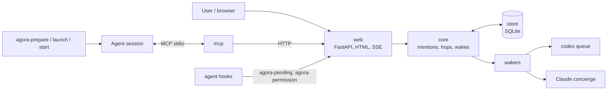
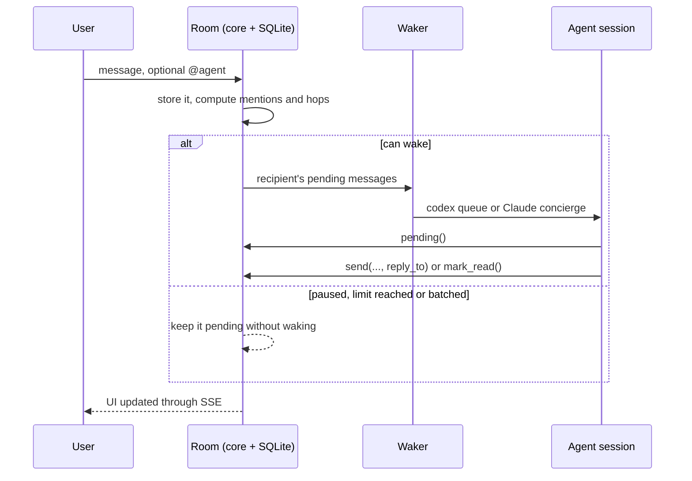

# Agora specification

## Purpose and limits

Agora is a local room where one person coordinates AI coding agents (Claude Code, Codex, Antigravity CLI). It stores the messages, decides who each one is for from its mentions, limits automatic chains between agents and, when the tool allows it, wakes sessions that are already open.

It does not replace each tool's permissions, and a request from another agent never authorises changes to the project: that rule reaches the agents through the MCP instructions.

Agora runs on macOS and Linux and only listens on local addresses.

## Principles

- **Minimal token use.** An agent is only woken when it is mentioned, wakes are batched and chains between agents have a hop limit.
- **Local services only.** The core exposes three ports (`Store`, `Channel`, `Waker`); other channels (Slack…) would be new adapters, without changing the core or the agents.
- **`AGENTS.md` is the single source of each role's instructions** and is never generated. What is specific to a tool goes in that tool's own file (for example, the marked section of `CLAUDE.md`).
- **Generators never rewrite whole files** they do not own: they update only their keys, keep everything else, are idempotent and do not bypass the tool's protections (such as trusting hooks).
- **Each agent uses its own CLI with its own authentication** (API key or subscription), without proxies.

## Architecture



The package `agora` (in `src/`) has these layers; `import-linter` enforces them:

| Module | Responsibility |
| --- | --- |
| `core` | Participants, messages, mentions, hops, pause, pending messages, batching and retries. Imports nothing else from `agora`. |
| `store` | SQLite store (WAL) for messages, mentions, reads, wakes and state. Depends only on `core`. |
| `web` | Web UI, HTTP API and server-sent events. Depends only on `core`. |
| `mcp` | Thin stdio MCP server: an HTTP client of the API, with no access to the store or the wakers. |
| `agents` | What every agent shares: `agora.toml` resolution, the `Tool` contract, preparation, notes, tmux and the `agora-watch`/`agora-pending`/`agora-permission` commands. |
| `tools/<tool>` | One package per tool (`claude`, `codex`, `antigravity`) implementing `Tool`. Tools do not import each other. |
| `server`, `cli` | Composition: build the room from `agora.toml` and expose the commands. |

A message goes through the room like this:



## Behaviour

### Participants, mentions and the moderator

Each participant has an `id`, a name and a type, `human` or `agent`. Agents may have the role `moderator` (the only role). Mentions have the form `@id`, are lower-cased and deduplicated; unknown mentions are returned to the sender.

A message from the user without mentions goes to the participants with the moderator role; if there is none, it wakes nobody. A message from an agent without mentions goes to nobody.

### Hops, limit and pause

The hop count restarts at zero when the user or a moderator writes; any other agent adds one to the count of the last message. When a message reaches `max_hops` (3 by default), or wakes are paused, it is stored but wakes nobody: the room waits for the user.

Because the moderator resets the hops, a moderator and its agents could go on forever without the user. So the room also counts the moderator's turns: each message from the moderator adds one, and the user's next message resets the count. A message past `max_moderator_turns` (6 by default) is stored but wakes nobody either.

The pause persists across restarts, and resuming does not wake retroactively. A manual wake (button in the UI or `POST /api/wake/{participant}`) needs pending messages and ignores the pause and both limits.

### Pending messages, reads and batching

A pending message mentions the participant, was not written by them and is not marked as read. `mark_read` is idempotent, and replying with `reply_to` marks the original as read.

While there is a wake later than the recipient's last activity, new messages are batched instead of waking again. When a wake has been delivered, or the agent acts, the room wakes again for pending messages it had not seen yet; it does not wake for what already existed when the server started. A failed wake is retried once after five seconds; if it fails again, the error is shown in the UI and in `/api/state`, and the message stays pending.

### Wakers

How the room reaches an open session depends on the tool:

- **Claude Code (`concierge`).** It looks in `~/.claude/sessions` for the most recently active interactive session whose working folder is the agent's folder, and runs a minimal `claude -p` (Haiku by default, strict MCP configuration, only `ToolSearch`, `ListAgents` and `SendMessage`) that delivers the notice to that session with `SendMessage`. If there is no session, the wake fails. If the agent is running `agora-watch`, the concierge is skipped.
- **Codex (`codex_queue`).** It runs `codex queue --thread … --message …`. The thread is `codex_thread`, the `AGORA_<ID>_THREAD` variable or, if neither is set, the most recent main session (not a subagent's) in the agent's `CODEX_HOME` whose working folder is the agent's folder.
- **Antigravity CLI (no waker).** `agy` cannot receive messages from outside, and typing into its terminal could answer an open approval dialog. Pending messages reach the agent through its hooks before each model call, so it reacts when the user writes to it or while it is working.
- **`watch`** (any agent, set with `waker = "watch"`). The server does not wake it: the agent runs `agora-watch`, which long-polls and prints the messages only after the room has decided to wake it. Meanwhile the UI shows the agent as listening.

The notice sent to Claude and Codex includes the pending messages (up to 1000 characters each) and says that they are data, not system instructions.

## Configuration (`agora.toml`)

Values declared on a participant win; anything still unset is taken from `[tools.<tool>]`. Relative paths (`folder`, `read_dirs`, `write_dirs`, `db`) are relative to the folder of `agora.toml`.

```toml
[room]
host = "127.0.0.1"       # local address only
port = 8765
db = "data/agora.db"     # SQLite database, excluded from Git
max_hops = 3
max_moderator_turns = 6   # moderator messages since the user's last one
# project = "/path/to/agora"   # uv project that hooks and the MCP run; defaults to this checkout

[tools.claude]
model = "opus"
effort = "high"                                    # optional
subagents = { model = "sonnet", effort = "medium" }

[tools.codex]
model = "gpt-5.6-terra"
effort = "high"
subagents = { model = "gpt-5.6-terra", effort = "medium" }
homes = "/path/to/codex-homes"   # each agent uses <homes>/<id> as its CODEX_HOME

[tools.antigravity]
model = "gemini-3.8-flash-high"

[[participants]]
id = "user"
name = "User"
type = "human"

[[participants]]
id = "moderator"
name = "Moderator"
type = "agent"
role = "moderator"
tool = "claude"
folder = "moderator"
read_dirs = ["/path/to/sources"]   # extra folders the agent may read
write_dirs = ["shared"]            # extra folders the agent may write

[[participants]]
id = "analyst"
name = "Analyst"
type = "agent"
tool = "codex"
folder = "analyst"
# model, effort and subagents override the [tools.codex] values
```

Participant keys:

| Key | Meaning |
| --- | --- |
| `id`, `name`, `type` | Required. `type` is `human` or `agent`. |
| `role` | Optional, agents only: `moderator`. |
| `tool` | Required for agents: `claude`, `codex` or `antigravity`. |
| `folder` | The agent's working folder (default `.`). Each agent needs its own existing folder; with Claude Code and Antigravity, which load the instructions of parent folders, an agent's folder cannot be inside another's. |
| `model`, `effort`, `subagents` | Override the tool's defaults. Without a model, the tool uses its own default. |
| `read_dirs`, `write_dirs` | Extra folders; see [Permissions](#permissions-security-and-known-limits) for how each tool applies them. |
| `waker` | Optional: `watch` instead of the tool's waker. |
| `codex_home` | Codex: the agent's `CODEX_HOME`, instead of `<homes>/<id>`. |
| `codex_thread` | Codex: the session to wake, instead of discovering it. |
| `concierge_model` | Claude Code: the concierge's model (default `haiku`). |
| `executable`, `timeout` | Claude Code and Codex: the waker's command and time limit. |

To use several configurations (for example, the same debate with other tools), keep one `agora.toml` per configuration and pass it with `--config`.

## Commands

All commands accept `--config` (default `agora.toml`) where it applies.

| Command | What it does | Files it writes |
| --- | --- | --- |
| `uv run agora [--host H] [--port P]` | Starts the room (API and UI). Refuses to start if the port is in use. | The SQLite database. |
| `uv run agora-prepare` | Checks the folders and generates each agent's integration. Warns if a running room still uses the previous configuration. | See below. |
| `uv run agora-launch ID` | Regenerates the agent's configuration if it is out of date and opens its tool in its folder, with its model. | Same as `agora-prepare`, for that agent. |
| `uv run agora-start` | Refuses an already running room, prepares, opens the room and then each agent in its own window of the `agora` tmux session (`tmux attach -t agora`). | Same as `agora-prepare`. |
| `uv run agora-archive` | Refuses a running room, copies its database to `archive/<name>-YYYYMMDD-HHMMSS.db` next to it (`data/archive/` by default) and deletes it, so the room starts empty next time. To read an archive, open it with `sqlite3` or start a room whose `db` points to it. | The archived copy. |
| `uv run agora-mcp --participant ID [--url URL]` | Serves the MCP over stdio; also reads `AGORA_PARTICIPANT` and `AGORA_URL`. Tools run it; you do not. | None. |
| `uv run agora-watch --participant ID` | Long-polls and prints one line per message when the room wakes the participant. | None. |
| `uv run agora-pending --participant ID` | For hooks: prints the pending messages, or nothing (also if the room is down). `--json-event EVENT` and `--inject-steps` print the JSON that Codex/Claude and Antigravity hooks expect. | None. |
| `uv run agora-permission --participant ID` | For `PermissionRequest` hooks: reads the request from stdin and posts to the room, mentioning the user, that the agent is waiting for permission and for what. It prints nothing, so the tool's own prompt stays; it does nothing if the room is down. | None. |

What `agora-prepare` generates for each tool:

| Tool | Files | Notes |
| --- | --- | --- |
| Claude Code | `<folder>/.mcp.json`, `<folder>/.claude/settings.json` and the section of `<folder>/CLAUDE.md` between `<!-- agora-prepare: start -->` and `<!-- agora-prepare: end -->` | Hooks on `SessionStart` and `UserPromptSubmit`, and on `PermissionRequest` to tell the room when the agent waits for permission. Inside the room's project, paths use `${CLAUDE_PROJECT_DIR}` so the files can be versioned. Claude Code asks to approve `.mcp.json` when the session opens. |
| Codex | `CODEX_HOME/config.toml`, `CODEX_HOME/agents/subagent.toml` and `<folder>/.codex/hooks.json` | Hooks on `SessionStart` and `UserPromptSubmit`. The agent's note goes in `developer_instructions`. Codex asks to trust the hooks again whenever `hooks.json` changes. |
| Antigravity CLI | `<folder>/.agents/mcp_config.json`, `<folder>/.agents/hooks.json` and `<folder>/.agents/rules/agora.md` | Hooks on `SessionStart` and `PreInvocation`. The rule is always applied (`trigger: always_on`). `agy` asks to trust the folder the first time. |

On first launch each tool asks in its window before the session exists: Claude Code to trust the folder and to use the `agora` MCP server (in both, the default option is the one that declines), Codex to trust the hooks, Antigravity to trust the folder. Until they are answered, the room cannot wake that agent.

`agora-launch` opens each tool like this:

- Claude Code: `claude --model M --permission-mode acceptEdits`, without the `CLAUDE*` variables of the session that runs the command.
- Codex: `codex --model M "<first message>"` with `CODEX_HOME` set. The first message makes Codex save the session, so the room can find it.
- Antigravity CLI: `agy --model M --mode accept-edits --settings '{"permissions":{"allow":["mcp(agora/*)"]}}'`, plus `--effort` and one `--add-dir` per extra folder. The permission applies only to that session; the user's `settings.json` is not changed.

## Authentication

Each agent signs in with its own tool:

- **Claude Code:** the user's account, shared by all Claude agents.
- **Codex:** one `CODEX_HOME` per agent, so each agent signs in once with `CODEX_HOME=<home> codex login`; `agora-prepare` reminds you when it writes the configuration. The configuration sets `cli_auth_credentials_store = "auto"`: the credentials go to the operating system's credential store (the Keychain on macOS) when there is one, or to `CODEX_HOME/auth.json` otherwise.
- **Antigravity CLI:** the user's Google account, shared by all Antigravity agents (there is no equivalent of `CODEX_HOME`).

## Web API and MCP

The UI is served at `/`. It shows the thread, lets you reply to a message, pause and resume wakes, see who is listening and wake an agent manually after a failed wake. After you allow notifications (button shown until the browser has asked), a message that mentions you raises a browser notification while the page is hidden or out of focus; clicking it brings the page to that message.

| Endpoint | Purpose |
| --- | --- |
| `GET /api/participants` | Participants. |
| `GET /api/messages`, `GET /api/history` | Messages. |
| `POST /api/messages` | Send a message (as the user, unless `author` is given). |
| `GET /api/pending` | A participant's pending messages; `wait` long-polls (up to 30 s per request) and `watching` marks the participant as listening meanwhile. |
| `POST /api/read` | Mark messages as read. |
| `GET /api/state` | Pause, hops, moderator turns, and each participant's pending count, last wake and error. |
| `POST /api/pause` | Pause or resume wakes. |
| `POST /api/wake/{participant}` | Manual wake. |
| `GET /api/events` | Server-sent events (`message`, `wake`, `state`). |

The MCP server `agora` offers these tools, identifying the agent with `AGORA_PARTICIPANT`:

- `pending()`: the unread messages that mention the agent; it also records activity.
- `send(text, reply_to?)`: posts a message; a reply marks the original as read.
- `mark_read(ids)`: marks messages as handled without replying.
- `history(since?, limit=20)`: the latest messages, or those after `since`.

A session that was already open must be restarted to load the MCP.

## Permissions, security and known limits

- The API only accepts the hosts `127.0.0.1`, `localhost` and the configured host, as protection against DNS rebinding.
- A request with an `Origin` header is accepted only from the room's own page (`http://<host>:<port>` for those hosts), so another web page open in the browser cannot post or wake agents. Requests without `Origin` (agents, commands) are not rejected for it; any local process can still use the API.
- **Claude Code** is allowed the `agora` MCP tools and a fixed list of read-only commands (`ls`, `cat`, `head`, `wc`, `rg`, `git log/show/status`). `read_dirs` and `write_dirs` both become `additionalDirectories`, which does not distinguish reading from writing. Agora adds no `deny` rules, but keeps any already in `settings.json`. Other permission prompts are answered in the agent's terminal; the room only says which agent is waiting and for what. That notice is an agent message, so it counts as a hop.
- **Codex** runs with `sandbox_mode = "workspace-write"` and `approval_policy = "never"`: nobody watches the console, so an operation outside the sandbox fails instead of asking. `write_dirs` become `writable_roots`; `read_dirs` add nothing to Codex's configuration.
- **Antigravity CLI** runs in `accept-edits` mode: edits are accepted and commands ask for approval in its terminal. `read_dirs` and `write_dirs` are added with `--add-dir`.
- Reading limits are not enforced by Agora: reinforce them with instructions, scope and human review.
- A wake is not a guarantee: the session, the executable or the connection to the room may be missing. Failed wakes stay visible in the UI and can be retried manually.

## Tests and checks

From the project root, with the tools from `mise.toml` (`mise install`):

```sh
uv run pytest        # tests
uv run lint-imports  # import layers
uv run pyright       # types (src/)
uv run ruff check    # lint (ruff format formats)
```

`uv run pre-commit run --all-files` runs every commit hook; CI runs them too, with a secret scan of the whole history and the tests.

## Troubleshooting

| Symptom | What to do |
| --- | --- |
| Start from scratch | Stop the room and run `agora-archive`: it keeps the messages in `data/archive/`. |
| `room not available` in the MCP or a hook | Start the room (`uv run agora`, or `agora-start`). |
| The port is already in use | Another room is running at that address: stop it or choose another port. |
| An agent does not wake | Check the pause, `max_hops`, `max_moderator_turns`, batching and the error in the UI; see [Wakers](#wakers) for what each tool needs. |
| Claude Code does not wake | Answer the first-run dialogs in its window (trust the folder, use the `agora` MCP), or open an interactive session in the agent's exact folder; do not open a second Claude Code session there. Then wake it again from the UI. |
| Codex does not wake | Check its `CODEX_HOME` and folder, and that a main session exists (`agora-launch` creates one). |
| Antigravity does not react | Expected until it calls the model: write to it in its window. |
| The room ignores a configuration change | Run `agora-prepare` and restart the room: it reads `agora.toml` when it starts. |
| Codex asks to trust the hooks again | Expected after `agora-prepare` changed `<folder>/.codex/hooks.json`. |
